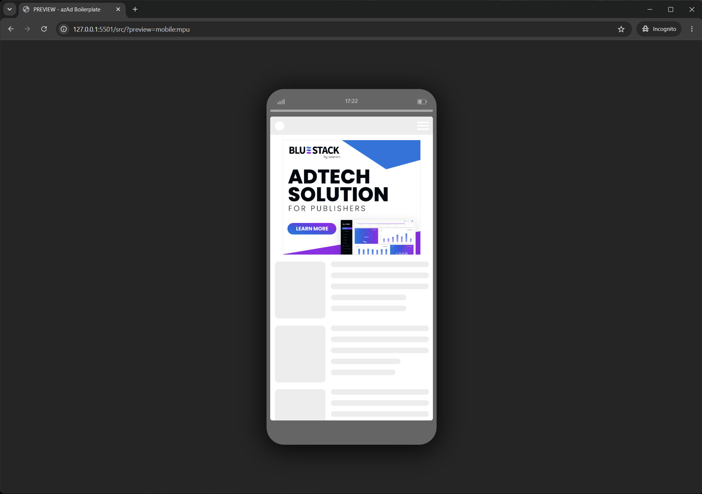
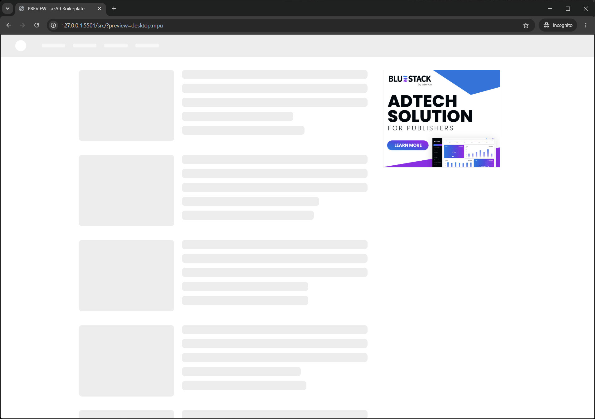

# azAd Preview Mode

Device preview for HTML display ads built with the azAd Boilerplate. Append `?preview=<size>` to an ad URL and the ad is shown inside a dummy phone or a dummy desktop website.

The script is loaded on demand by `azAd.js` (only when `?preview=` is in the URL) and served via [jsDelivr](https://www.jsdelivr.com/) from this repository.

  

---

## Project Structure

```
src/
  azPreview.js       # Preview script (source)
  azPreview.scss     # Preview styles (source)

dist/                # Build output — served via jsDelivr
  azPreview.min.js
  azPreview.css
  azPreview.min.css

demo/                # Local test ad, loads the preview from ../dist/
  index.html
  azAd.js            # Copy of the boilerplate's azAd.js with the dev-mode lines enabled
  style.min.css
```

---

## Usage

### Phone preview (default)

```
index.html?preview=mrec
index.html?preview=phone:mrec
```

### Desktop preview
```
index.html?preview=desktop:mrec
index.html?preview=desktop:superbanner
```

### Supported named sizes

| Name | Width | Height | Notes |
|------|-------|--------|-------|
| `mrec` / `mpu` | 300px | 250px | |
| `hpa` | 300px | 600px | Half Page Ad |
| `banner` | 320px | 50px | Mobile banner |
| `superbanner` | 728px | 90px | Desktop leaderboard |
| `skyscraper` | 160px | 600px | |
| `billboard` | 970px | 250px | |
| `int` | full | full | Interstitial |

New named sizes only need an entry in the `AD_SIZES` map in `src/azPreview.js`.

### Custom dimensions
```
index.html?preview=500x400
index.html?preview=desktop:970x250
```

Desktop previews wider than 340px are automatically placed above the article content instead of in the sidebar.

On a real mobile device (screen ≤ 480px), the phone frame is skipped and the dummy website renders as a normal page.

---

## Integration with azAd.js

`azAd.js` loads the preview like this:

```js
if (getUrlParam('preview')) {
	window.AZ_PREVIEW_CSS = 'https://cdn.jsdelivr.net/gh/behring5/azAd-Preview-mode@1/dist/azPreview.min.css';
	const script = document.createElement('script');
	script.src = 'https://cdn.jsdelivr.net/gh/behring5/azAd-Preview-mode@1/dist/azPreview.min.js';
	script.async = false;
	document.head.appendChild(script);
}
```

`azPreview.js` relies on this contract with the ad page:

- `window.AZ_PREVIEW_CSS` — URL of the preview stylesheet
- the global helpers `getUrlParam()` and `create()` from `azAd.js`

`@1` resolves to the latest `1.x.x` release, so fixes reach existing ads without rebuilding them. Breaking changes to the contract above require a new major version (`@2`). Pin an exact version (e.g. `@1.0.0`) instead if an ad must never change.

---

## Development

```bash
npm install        # install dependencies (first time only)
npm run build      # compile SCSS → CSS, minify JS, add version banners
npm run watch      # auto-recompile the preview styles on save
```

To test changes, run `npm run build` and open `demo/index.html?preview=mrec` via a local web server (e.g. VS Code Live Server). The demo loads the preview from `../dist/` instead of the CDN.

---

## Releasing / CDN

1. Update `version` in `package.json`
2. Run `npm run build` — the version is written into the banners of all output files
3. Commit, create a git tag matching the version (e.g. `v1.0.1`) and push commit and tag

The files are then available at:

```
https://cdn.jsdelivr.net/gh/behring5/azAd-Preview-mode@1.0.1/dist/azPreview.min.js   # exact version
https://cdn.jsdelivr.net/gh/behring5/azAd-Preview-mode@1/dist/azPreview.min.js       # latest 1.x.x
```

jsDelivr caches version ranges like `@1` for a while, so a new release can take some time to show up there. A cache purge can be requested at [jsdelivr.com/tools/purge](https://www.jsdelivr.com/tools/purge).
